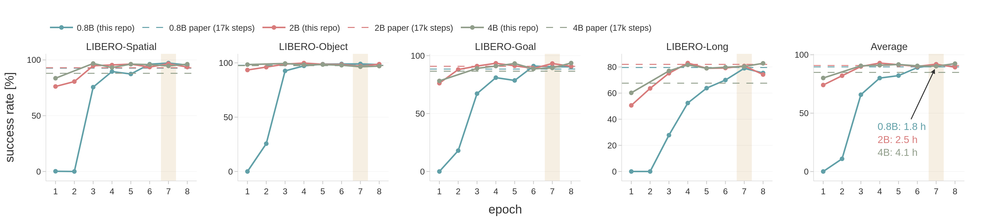

# Reproducing the LIBERO results

This page reports LIBERO results obtained with this repository on 8 × H200 (141 GB), for the released models and for models trained from scratch with the configs in [`configs/`](../configs/).

Every number is the success rate over 500 episodes per suite (10 tasks × 50 initial states), evaluated with `pixi run eval` (seed 7, action horizon 8).
With 500 episodes, the standard error of one suite is about 1-2 points.

## Released models

| Model | Spatial [%] | Object [%] | Goal [%] | Long [%] | Avg [%] |
|---|---:|---:|---:|---:|---:|
| [CLAP-Qwen3.5-0.8B](https://huggingface.co/omron-sinicx/CLAP-Qwen3.5-0.8B) | 94.8 | 98.8 | 91.8 | 79.6 | 91.3 |
| Paper (Table 1), 0.8B | 92.6 | 97.8 | 88.4 | 79.6 | 89.6 |
| [CLAP-Qwen3.5-2B](https://huggingface.co/omron-sinicx/CLAP-Qwen3.5-2B) | 92.8 | 97.2 | 88.8 | 82.4 | 90.3 |
| Paper (Table 1), 2B | 93.0 | 97.4 | 90.8 | 82.0 | 90.8 |
| [CLAP-Qwen3.5-4B](https://huggingface.co/omron-sinicx/CLAP-Qwen3.5-4B) | 92.2 | 97.2 | 89.4 | 71.6 | 87.6 |
| Paper (Table 1), 4B | 88.0 | 97.4 | 86.6 | 67.6 | 84.9 |

## Training with this repository

`pixi run train clap_0.8b`, `pixi run train clap_2b` and `pixi run train clap_4b` (128 samples per step; 4B uses batch 8 with 2 gradient accumulation steps, since batch 16 does not fit in 141 GB).
The configs train for **7 epochs**, which takes **1.8 h (0.8B)**, **2.5 h (2B)** and **4.1 h (4B)** on 8 × H200.
The runs below were trained for 8 epochs (= the 17k steps of the paper; see the note at the end of the README) and evaluated after every epoch; the 4B run was continued to 10 epochs, and epochs 9-10 are listed for reference only (not in the figure).
The learning rate is constant, so their epoch-7 checkpoints are what the 7-epoch configs produce.



Solid lines: checkpoints of this repository after each epoch (2,136 steps per epoch). Dashed lines: the paper's 17k-step results (Table 1). Shaded: epoch 7, the default of the configs. Arrow: training time to epoch 7 on 8 × H200.

**CLAP-0.8B**

| Epoch | Steps | Training hours [h] | Spatial [%] | Object [%] | Goal [%] | Long [%] | Avg [%] |
|---:|---:|---:|---:|---:|---:|---:|---:|
| 1 | 2,136 | 0.3 | 0.2 | 0.0 | 0.0 | 0.0 | 0.1 |
| 2 | 4,272 | 0.5 | 0.0 | 25.6 | 18.0 | 0.0 | 10.9 |
| 3 | 6,408 | 0.8 | 75.6 | 92.6 | 67.2 | 27.8 | 65.8 |
| 4 | 8,544 | 1.0 | 89.6 | 97.2 | 81.0 | 52.4 | 80.1 |
| 5 | 10,680 | 1.3 | 87.4 | 98.8 | 78.6 | 63.8 | 82.2 |
| 6 | 12,816 | 1.5 | 96.2 | 99.0 | 91.0 | 70.0 | 89.1 |
| 7 | 14,952 | 1.8 | 97.2 | 99.0 | 90.4 | 79.0 | **91.4** |
| 8 | 17,088 | 2.0 | 95.4 | 98.4 | 90.4 | 75.4 | 89.9 |
| Paper (Table 1) | 17k | | 92.6 | 97.8 | 88.4 | 79.6 | 89.6 |

**CLAP-2B**

| Epoch | Steps | Training hours [h] | Spatial [%] | Object [%] | Goal [%] | Long [%] | Avg [%] |
|---:|---:|---:|---:|---:|---:|---:|---:|
| 1 | 2,136 | 0.4 | 76.2 | 93.4 | 76.2 | 50.6 | 74.1 |
| 2 | 4,272 | 0.7 | 80.6 | 96.0 | 88.0 | 63.6 | 82.1 |
| 3 | 6,408 | 1.1 | 94.8 | 98.8 | 91.0 | 75.2 | 90.0 |
| 4 | 8,544 | 1.4 | 95.4 | 99.8 | 93.4 | 83.0 | **92.9** |
| 5 | 10,680 | 1.8 | 96.2 | 98.6 | 91.2 | 79.0 | 91.3 |
| 6 | 12,816 | 2.1 | 93.6 | 98.4 | 89.0 | 79.2 | 90.1 |
| 7 | 14,952 | 2.5 | 96.6 | 97.0 | 93.2 | 80.8 | 91.9 |
| 8 | 17,088 | 2.8 | 93.6 | 98.8 | 90.8 | 74.2 | 89.4 |
| Paper (Table 1) | 17k | | 93.0 | 97.4 | 90.8 | 82.0 | 90.8 |

**CLAP-4B**

| Epoch | Steps | Training hours [h] | Spatial [%] | Object [%] | Goal [%] | Long [%] | Avg [%] |
|---:|---:|---:|---:|---:|---:|---:|---:|
| 1 | 2,136 | 0.6 | 83.6 | 98.4 | 78.2 | 60.2 | 80.1 |
| 2 | 4,272 | 1.2 | n/a | n/a | n/a | n/a | n/a |
| 3 | 6,408 | 1.8 | 96.8 | 99.4 | 89.0 | 77.0 | 90.6 |
| 4 | 8,544 | 2.4 | 93.2 | 98.2 | 91.0 | 81.6 | 91.0 |
| 5 | 10,680 | 3.0 | 96.2 | 98.4 | 93.2 | 79.0 | 91.7 |
| 6 | 12,816 | 3.6 | 95.8 | 97.8 | 88.6 | 79.8 | 90.5 |
| 7 | 14,952 | 4.1 | 94.6 | 96.4 | 89.4 | 80.4 | 90.2 |
| 8 | 17,088 | 4.7 | 96.2 | 97.0 | 93.6 | 82.8 | **92.4** |
| 9 (reference) | 19,224 | 5.3 | 93.4 | 96.6 | 92.0 | 87.0 | 92.3 |
| 10 (reference) | 21,360 | 5.9 | 94.0 | 94.4 | 92.4 | 82.4 | 90.8 |
| Paper (Table 1) | 17k | | 88.0 | 97.4 | 86.6 | 67.6 | 84.9 |

4B epoch 2: not available. On several tasks the LIBERO simulator crashed during rendering or stalled, on three different nodes, so the suites could not be completed.

Observations:

- **8 epochs (= 17k steps, as in the paper) reproduce the paper's average**: 0.8B 89.9 (paper 89.6) and 2B 89.4 (paper 90.8). This is the like-for-like comparison with the paper.
- **4B scores higher than in the paper**: 92.4 after 8 epochs against 84.9 in Table 1, mostly on Spatial (96.2 vs 88.0) and Long (82.8 vs 67.6). With this repository, 4B is on par with 2B rather than below it.
- **7 epochs are as good with less training**: 0.8B 91.4 and 2B 91.9 on average, and 79.0 / 80.8 on Long; 4B reaches 90.2. The configs use 7 epochs for this reason. Note that this choice was made by looking at these LIBERO results (there is no separate validation set), so the epoch-7 numbers are somewhat optimistic; the epoch-8 numbers above are not selected.
- **LIBERO-Long varies by several points between neighbouring checkpoints** (2B: 83.0, 79.0, 79.2, 80.8, 74.2 for epochs 4-8), so a single checkpoint can land below the paper on Long. The checkpoints of the paper's run behave the same way: evaluated with this code, 2B scores 80.4 on Long after 17k steps and 82.4 after 18k (the released model).
- **2B learns faster**: it reaches 90% average after 3 epochs (1.1 h) and is best after 4 epochs (92.9%). 0.8B is close to 0% after 1-2 epochs and catches up after 6-7 epochs (best 91.4% after 7 epochs).
- After the peak the average stays at about 90-92% (4B: 92.3 and 90.8 after 9 and 10 epochs). In the paper's appendix (Figure 7), where 2B is trained up to 102k steps with the VLA-0 codebase, CLAP likewise peaks early (94.3% at 51k steps) and then plateaus around 92%.

## Regenerating the figure

```bash
pixi run --script docs/assets/collect_training_curve.py > docs/assets/training_curve.csv  # reads eval/logs/
pixi run --script docs/assets/plot_training_curve.py                                     # writes docs/assets/training_curve.png
```
